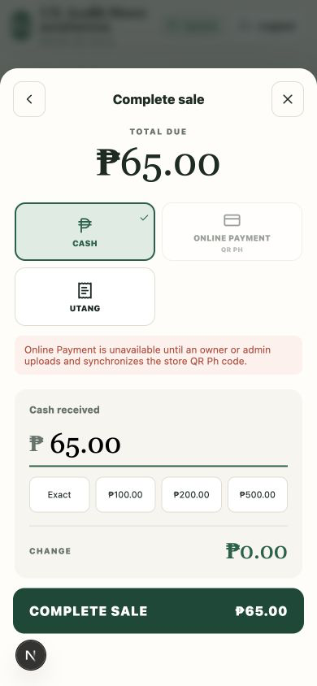

# Store POS

Mobile-first, offline-first sari-sari store POS built with Next.js, TypeScript, Dexie, NestJS, Express, PostgreSQL, and MinIO.

Course project: CCE106L Applications Development and Emerging Technologies.

## Preview



Recorded interface screenshot from the October 2026 UI audit.

## Features

- Checkout and sale records that operate from the local browser database.
- Inventory tracking, including the smallest sellable unit.
- Customer credit (utang), payment records, expenses, and reports.
- Owner, admin, superadmin, and cashier workflows.
- Encrypted browser-generated cloud backups when connectivity is available.

This repository demonstrates an application prototype; it does not establish a commercial production deployment.

## Architecture

```text
Next.js PWA → Dexie / IndexedDB (working data)
           → NestJS / Express API → PostgreSQL
           → encrypted backup upload → MinIO object storage
```

## Review the offline workflow

1. Create a store and add products through the owner/admin workflow.
2. Sign in as a cashier and record a cash sale.
3. Disconnect networking in the browser and record another sale.
4. Confirm local stock and sale records update while offline.
5. Reconnect and inspect the backup workflow.

Recorded views: [completed sale](docs/ui-ux-audit/2026-10-02/07-sale-completed.png), [offline cashier](docs/ui-ux-audit/2026-10-02/16-cashier-offline.png), and [queued offline sale](docs/ui-ux-audit/2026-10-02/17-offline-sale-queued.png). These screenshots show the recorded UI, not a new acceptance-test run.

## Development checks

```bash
npm test
npm run typecheck
npm run build
```

The repository also includes real-stack and final-QA scripts. Inspect their environment requirements before running them.

## Local development

1. Install and select the Node.js version in `.nvmrc` with `nvm install && nvm use`.
2. Copy `.env.example` to `.env` and change the JWT secret and superadmin credentials.
3. Start PostgreSQL and MinIO with `docker compose up -d --build`.
4. Install dependencies with `npm install`.
5. Apply the database migration with `npm run db:migrate`.
6. Start the PWA and API with `npm run dev`.

The PWA opens at `http://localhost:3000` and the API at `http://localhost:4000`.

The API creates or updates the configured superadmin account on startup when `SUPERADMIN_EMAIL` and `SUPERADMIN_PASSWORD` are set. Sign in through the Owner / Admin / Superadmin tab to create stores and assign owner/admin access.

## Offline model

The browser database is the working source of truth. Checkout, inventory, utang, expenses, and reports never wait for the API. Cloud backups are encrypted in the browser and uploaded only when connectivity is available.

Amounts are stored as integer centavos. Inventory is stored in the product's smallest sellable unit.
